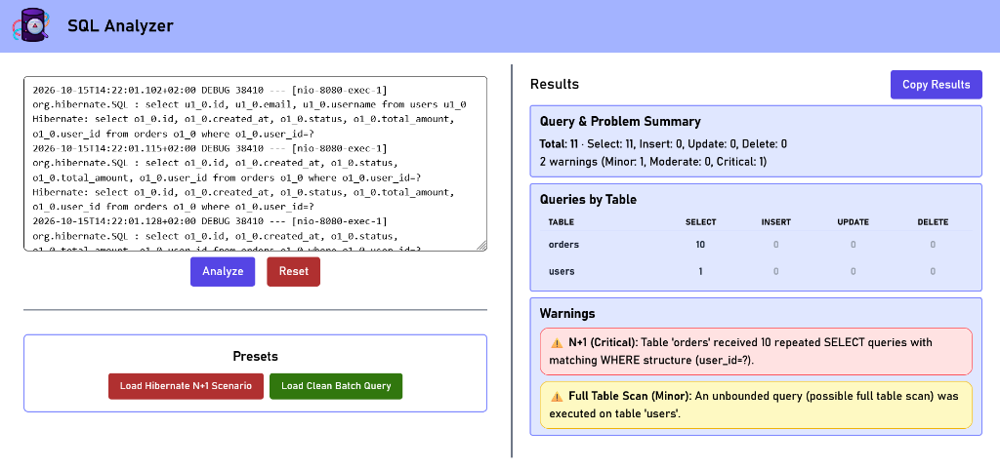

# SQL Analyzer 🔍

[](https://react.dev/)
[](https://www.typescriptlang.org/)
[](https://tailwindcss.com/)
[](https://vite.dev/)
[](https://melina-danhier.github.io/sql-analyzer/)

A lightweight, client-side web application to inspect, analyze, and detect performance bottlenecks and dangerous queries in SQL and Hibernate logs.

🔗 **Live Demo:** [https://melina-danhier.github.io/sql-analyzer/](https://melina-danhier.github.io/sql-analyzer/)



---

## ⚠️ Problem Analysis: Why N+1 Queries in JPA/Hibernate Are Dangerous

The **N+1 query problem** is one of the most common and critical performance bottlenecks in enterprise applications relying on ORM frameworks like **Hibernate** and **Spring Data JPA**.

### How the Problem Arises
1. **1 Initial Query**: The application retrieves a collection of $N$ parent entities (e.g., 100 users):
   ```sql
   SELECT * FROM users;
   ```
2. **N Additional Queries**: Accessing a lazily loaded association (e.g., calling `user.getOrders()` inside a loop or during JSON serialization) triggers Hibernate to execute an additional query for *each individual record*:
   ```sql
   SELECT * FROM orders WHERE user_id = ?; -- executed 100 times!
   ```
Instead of a single coordinated `JOIN` query, the application suddenly fires **$1 + 100 = 101$ database queries**.

### Why It Is Fatal in Production
- **The "Silent Killer" in Development**: With only 3–5 sample records in local databases, 4–6 fast queries take just a few milliseconds and go unnoticed. Under production load with thousands of records, the query count explodes instantly.
- **Latency from Network Round-Trips**: Even with a low 1 ms ping between application server and database, 1,000 individual queries add at least one full second of pure idle network waiting time per HTTP request.
- **Connection Pool Exhaustion (HikariCP)**: Hundreds of rapid consecutive queries saturate database connections. Under concurrent user traffic, this quickly leads to connection timeouts and cascading system downtime.
- **Database Overhead**: Parsing, planning, and executing hundreds of small statements wastes significant CPU and I/O capacity on the database server.

### How to Resolve N+1 Issues
- Use **`JOIN FETCH`** in JPQL / HQL queries
- Define **Entity Graphs** (`@EntityGraph`)
- Enable **Batch Fetching** via `@BatchSize(size = ...)` or `hibernate.default_batch_fetch_size`
- Employ **DTO Projections** for read-only use cases

---

## ✨ Features

- **Automated Log Parsing**:
  - Supports raw SQL logs as well as Spring Boot / Hibernate logs (both single-line and formatted multi-line logs with `format_sql=true`).
  - Automatically strips log metadata prefixes (timestamps, thread identifiers, `Hibernate:`, `org.hibernate.SQL`).

- **Performance & Anti-Pattern Detection**:
  - **N+1 Query Detection**: Identifies repeated `SELECT` statements executed against the same table with matching `WHERE` filter structures.
  - **Dangerous Statements**: Highlights high-risk `UPDATE` and `DELETE` operations executed without a `WHERE` clause.
  - **Missing Batching**: Flags loops of individual `INSERT` statements that should be batched together.
  - **Iterative Updates**: Detects repetitive single-record updates with normalized filter structures.
  - **Full Table Scans / Unbounded Queries**: Warns about unbounded `SELECT` queries missing `WHERE` filters or `LIMIT` clauses.
  - **Query Count Warning**: Alerts when overall query traffic exceeds safe thresholds.

- **Breakdown by Table**:
  - Clear summary matrix categorizing CRUD operations (`SELECT`, `INSERT`, `UPDATE`, `DELETE`) per database table.

- **Presets**:
  - Quick-load realistic sample scenarios (*Hibernate N+1 Scenario*, *Clean Batch Query*) to test immediately.

- **Export & Copy**:
  - One-click button to export the full analysis summary formatted as clean, Markdown-ready text.

---

## 🛠️ Tech Stack

- **Framework**: [React 19](https://react.dev/)
- **Language**: [TypeScript](https://www.typescriptlang.org/)
- **Bundler & Dev Server**: [Vite](https://vite.dev/)
- **Styling**: [Tailwind CSS v4](https://tailwindcss.com/)

---

## 🚀 Getting Started

### Prerequisites

Ensure you have [Node.js](https://nodejs.org/) (version 18+ recommended) installed.

### Installation

1. Clone or download the repository.
2. Install dependencies:
   ```bash
   npm install
   ```

### Running the Development Server

```bash
npm run dev
```
Open the URL printed in the terminal (usually `http://localhost:5173`).

### Building for Production

Type-check and produce the optimized production build:
```bash
npm run build
```
The production bundle will be generated in the `dist/` directory.

---

## 📄 License

MIT
