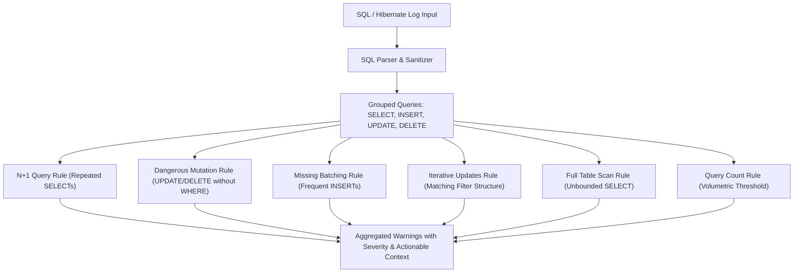

# SQL Analyzer 🔍

[](https://github.com/melina-danhier/sql-analyzer/actions/workflows/ci.yml)
[](https://github.com/melina-danhier/sql-analyzer/actions/workflows/deploy.yml)
[](https://react.dev/)
[](https://www.typescriptlang.org/)
[](https://tailwindcss.com/)
[](https://vite.dev/)
[](https://melina-danhier.github.io/sql-analyzer/)

A lightweight, client-side web application to inspect, analyze, and detect performance bottlenecks and dangerous queries in SQL and Hibernate logs.

🔗 **Live Demo:** [https://melina-danhier.github.io/sql-analyzer/](https://melina-danhier.github.io/sql-analyzer/)


---

## ⚠️ Problem Analysis: Why N+1 Queries in JPA/Hibernate Are Dangerous

The **N+1 query problem** is one of the most common and critical performance bottlenecks in enterprise applications relying on ORM frameworks like **Hibernate** and **Spring Data JPA**.

### How the Problem Arises
1. **1 Initial Query**: The application retrieves a collection of $N$ parent entities (e.g., 100 users):
   ```sql
   SELECT * FROM users;
   ```
2. **N Additional Queries**: Accessing a lazily loaded association (e.g., calling `user.getOrders()` inside a loop or during JSON serialization) triggers Hibernate to execute an additional query for *each individual record*:
   ```sql
   SELECT * FROM orders WHERE user_id = ?; -- executed 100 times!
   ```
Instead of a single coordinated `JOIN` query, the application suddenly fires **$1 + 100 = 101$ database queries**.

### Why It Is Fatal in Production
- **The "Silent Killer" in Development**: With only 3–5 sample records in local databases, 4–6 fast queries take just a few milliseconds and go unnoticed. Under production load with thousands of records, the query count explodes instantly.
- **Latency from Network Round-Trips**: Even with a low 1 ms ping between application server and database, 1,000 individual queries add at least one full second of pure idle network waiting time per HTTP request.
- **Connection Pool Exhaustion (HikariCP)**: Hundreds of rapid consecutive queries saturate database connections. Under concurrent user traffic, this quickly leads to connection timeouts and cascading system downtime.
- **Database Overhead**: Parsing, planning, and executing hundreds of small statements wastes significant CPU and I/O capacity on the database server.

### How to Resolve N+1 Issues
- Use **`JOIN FETCH`** in JPQL / HQL queries
- Define **Entity Graphs** (`@EntityGraph`)
- Enable **Batch Fetching** via `@BatchSize(size = ...)` or `hibernate.default_batch_fetch_size`
- Employ **DTO Projections** for read-only use cases

---

## 🔬 Heuristic Analysis, Rules & Operational Boundaries

> [!IMPORTANT]
> **Heuristic Static Indicators vs. Real-world Runtime Profiling**:
> The SQL Analyzer operates purely on **static log patterns and query frequency**. It does not connect to a live database, execute `EXPLAIN` query plans, or measure real-time wall-clock latency (ms), I/O block reads, or connection pool wait events.
>
> **Why this design is intentional**: Local runtime benchmarks on in-memory databases (e.g., H2) are deceptive: 100 N+1 queries might execute in 2 ms locally but cause production outages under load. Static pattern recognition uncovers the structural architectural flaw *before* code hits production.

For detailed German interview talking points and deep-dive technical reasoning, see the companion guide: [📖 docs/ANALYSIS_BOUNDARIES.md](./docs/ANALYSIS_BOUNDARIES.md).



### Detailed Rule Catalog

#### 1. N+1 Query Detection (`checkNPlusOne`)
- **Pattern Recognized**: Multiple `SELECT` queries executed against the same table with matching normalized `WHERE` filter structures.
  - Normalization removes table aliases (e.g. `o1_0.customer_id` $\rightarrow$ `customer_id`), collapses `IN (?, ?, ?)` to `IN (?)`, masks literals and numbers with `?`, and strips whitespace.
- **Severity Thresholds**:
  - `Minor` (Level 1): $\ge 3$ repeated queries
  - `Moderate` (Level 2): $\ge 6$ repeated queries
  - `Critical` (Level 3): $\ge 10$ repeated queries
- **Hit Example (Treffer)**:
  ```sql
  SELECT id, total FROM orders WHERE customer_id = 101;
  SELECT id, total FROM orders WHERE customer_id = 102;
  SELECT id, total FROM orders WHERE customer_id = 103;
  ```
  *Result*: Flags table `'orders'` with 3 repeated queries matching `WHERE (customer_id = ?)`.
- **Non-Hit Example (Nicht-Treffer)**:
  ```sql
  -- Efficient batch fetch using IN list (single query):
  SELECT id, total, customer_id FROM orders WHERE customer_id IN (101, 102, 103);
  -- Queries on different tables or with completely different filter structures:
  SELECT id, name FROM customers WHERE id = 101;
  SELECT id, total FROM orders WHERE status = 'COMPLETED';
  ```
- **Boundaries, Complex SQL & Potential False Positives**:
  - *False Positive*: Intentional client polling or distinct independent business requests logged together.
  - *Complex SQL Limitation*: Subqueries or inverted WHERE condition order (`WHERE a = ? AND b = ?` vs `WHERE b = ? AND a = ?`) will not be treated as identical without full AST parsing.

---

#### 2. Dangerous Statement / Mutation Without Filter (`checkMutationWithoutFilter`)
- **Pattern Recognized**: An `UPDATE` or `DELETE` query executed without a `WHERE` clause (checked via parsed AST properties and regex on SQL text stripped of comments and string literals).
- **Severity**: Always `Critical` (Level 3).
- **Hit Example (Treffer)**:
  ```sql
  DELETE FROM sessions;
  UPDATE user_accounts SET is_active = false;
  ```
- **Non-Hit Example (Nicht-Treffer)**:
  ```sql
  DELETE FROM sessions WHERE expires_at < NOW();
  UPDATE user_accounts SET is_active = false WHERE failed_attempts >= 5;
  -- String literals containing the word 'where' are ignored:
  UPDATE articles SET title = 'Where is the documentation?' WHERE id = 1;
  ```
- **Boundaries, Complex SQL & Potential False Positives**:
  - *False Positive*: Intentional maintenance operations (e.g. purging staging or temporary tables: `DELETE FROM staging_import;`).
  - *Complex SQL Limitation*: `TRUNCATE TABLE` is a DDL command and not classified as `DELETE`. Tautological filters like `WHERE 1=1` are syntactically present, so they bypass this rule.

---

#### 3. Missing Batching on INSERT (`checkMissingBatchingInsert`)
- **Pattern Recognized**: High frequency of single-row `INSERT` statements targeting the same table.
- **Severity Thresholds**:
  - `Minor` (Level 1): $\ge 3$ inserts
  - `Moderate` (Level 2): $\ge 6$ inserts
  - `Critical` (Level 3): $\ge 10$ inserts
- **Hit Example (Treffer)**:
  ```sql
  INSERT INTO audit_log (action, user_id) VALUES ('LOGIN', 10);
  INSERT INTO audit_log (action, user_id) VALUES ('SEARCH', 10);
  INSERT INTO audit_log (action, user_id) VALUES ('LOGOUT', 10);
  ```
- **Non-Hit Example (Nicht-Treffer)**:
  ```sql
  -- Multi-row batch insert:
  INSERT INTO audit_log (action, user_id) VALUES 
      ('LOGIN', 10), ('SEARCH', 10), ('LOGOUT', 10);
  -- Less than 3 inserts:
  INSERT INTO users (id, name) VALUES (1, 'Alice');
  ```
- **Boundaries, Complex SQL & Potential False Positives**:
  - *False Positive*: Inserts executed minutes apart by separate user threads in an aggregated server log cannot be batched across independent HTTP requests.
  - *ORM Limitation (`GenerationType.IDENTITY`)*: When using JPA identity ID generation, Hibernate disables batching by design to immediately read generated IDs via JDBC `getGeneratedKeys()`.

---

#### 4. Iterative Updates (`checkIterativeUpdates`)
- **Pattern Recognized**: Repeated single-record `UPDATE` queries on the same table with matching normalized `WHERE` filter structures.
- **Severity Thresholds**:
  - `Minor` (Level 1): $\ge 3$ updates
  - `Moderate` (Level 2): $\ge 5$ updates
  - `Critical` (Level 3): $\ge 9$ updates
- **Hit Example (Treffer)**:
  ```sql
  UPDATE inventory SET stock = 10 WHERE item_id = 1;
  UPDATE inventory SET stock = 15 WHERE item_id = 2;
  UPDATE inventory SET stock = 20 WHERE item_id = 3;
  ```
- **Non-Hit Example (Nicht-Treffer)**:
  ```sql
  -- Set-based bulk update in a single query:
  UPDATE inventory SET stock = stock - 1 WHERE category_id = 5;
  ```
- **Boundaries, Complex SQL & Potential False Positives**:
  - *False Positive*: Updating different sets of fields on different entities via JPA dirty checking in a long transaction.
  - *Architectural Trade-off*: Bulk updates in JPQL bypass the Hibernate 1st-level cache and optimistic locking (`@Version`). Developers sometimes intentionally use iterative updates to preserve cache coherency and version checks.

---

#### 5. Full Table Scans / Unbounded Queries (`checkFullTableScans`)
- **Pattern Recognized**: A `SELECT` query lacking both a `WHERE` filter and pagination/limiting keywords (`LIMIT`, `TOP`, `FETCH FIRST/NEXT`).
- **Severity**: `Minor` (Level 1).
- **Hit Example (Treffer)**:
  ```sql
  SELECT id, name, email FROM customers;
  SELECT * FROM audit_events;
  ```
- **Non-Hit Example (Nicht-Treffer)**:
  ```sql
  SELECT id, name FROM customers WHERE is_active = true;
  SELECT id, name FROM customers ORDER BY created_at DESC LIMIT 50;
  SELECT TOP 20 * FROM audit_events;
  SELECT * FROM customers OFFSET 0 ROWS FETCH NEXT 25 ROWS ONLY;
  ```
- **Boundaries, Complex SQL & Potential False Positives**:
  - *False Positive (Lookup Tables)*: For small static dictionary tables (e.g. `countries` with 195 rows), a full table scan is the fastest and optimal access path chosen by the database Cost-Based Optimizer (CBO), outperforming index scans.
  - *False Negative (Unindexed Filter)*: `SELECT * FROM big_table WHERE unindexed_col = 'xyz'` passes this rule, yet causes a 100% full table scan in the database engine.

---

#### 6. Overall Query Count (`checkCountAll`)
- **Pattern Recognized**: Total volumetric count of all statements (`SELECT` + `INSERT` + `UPDATE` + `DELETE`) in the analyzed input.
- **Severity Thresholds**:
  - `Minor` (Level 1): $\ge 20$ queries
  - `Moderate` (Level 2): $\ge 40$ queries
  - `Critical` (Level 3): $\ge 80$ queries
- **Hit Example (Treffer)**: A log snippet containing 25 queries.
- **Non-Hit Example (Nicht-Treffer)**: A log snippet containing 15 queries.
- **Boundaries, Complex SQL & Potential False Positives**:
  - *Context Sensitivity*: 25 queries inside a single HTTP request lifecycle is an urgent performance risk. Conversely, 80 queries inside a multi-step background ETL synchronization is normal and benign.

---

### Comparison & Reference Matrix

| Rule | Severity | Pattern Recognized | Threshold | Typical False Positive | Recommended Solution |
|---|---|---|---|---|---|
| **N+1** | Minor $\rightarrow$ Critical | Repeated `SELECT`s with matching `WHERE` | $\ge 3 / 6 / 10$ | Intentional pagination/polling | `JOIN FETCH`, `@EntityGraph`, `@BatchSize` |
| **Dangerous Statement** | Critical | `UPDATE` / `DELETE` without `WHERE` | 1 query | Staging/temp table cleanup | Add filter, wrap in transaction |
| **Missing Batching** | Minor $\rightarrow$ Critical | Repeated single-row `INSERT`s | $\ge 3 / 6 / 10$ | Dispersed user actions across time | `hibernate.jdbc.batch_size`, multi-row INSERTs |
| **Iterative Updates** | Minor $\rightarrow$ Critical | Repeated `UPDATE`s with matching `WHERE` | $\ge 3 / 5 / 9$ | JPA dirty checking on dirty entities | Bulk JPQL update, batching |
| **Full Table Scan** | Minor | `SELECT` without `WHERE` or `LIMIT` | 1 query | Small lookup/code tables | Add `LIMIT`, `FETCH FIRST`, or pagination |
| **Query Count** | Minor $\rightarrow$ Critical | Total queries across all types | $\ge 20 / 40 / 80$ | Long log traces, batch jobs | Second-level caching, DTO projections |

---

## ✨ Features

- **Automated Log Parsing**:
  - Supports raw SQL logs as well as Spring Boot / Hibernate logs (both single-line and formatted multi-line logs with `format_sql=true`).
  - Automatically strips log metadata prefixes (timestamps, thread identifiers, `Hibernate:`, `org.hibernate.SQL`).

- **Performance & Anti-Pattern Detection**:
  - **N+1 Query Detection**: Identifies repeated `SELECT` statements executed against the same table with matching `WHERE` filter structures.
  - **Dangerous Statements**: Highlights high-risk `UPDATE` and `DELETE` operations executed without a `WHERE` clause.
  - **Missing Batching**: Flags loops of individual `INSERT` statements that should be batched together.
  - **Iterative Updates**: Detects repetitive single-record updates with normalized filter structures.
  - **Full Table Scans / Unbounded Queries**: Warns about unbounded `SELECT` queries missing `WHERE` filters or `LIMIT` clauses.
  - **Query Count Warning**: Alerts when overall query traffic exceeds safe thresholds.

- **Breakdown by Table**:
  - Clear summary matrix categorizing CRUD operations (`SELECT`, `INSERT`, `UPDATE`, `DELETE`) per database table.

- **Presets**:
  - Quick-load realistic sample scenarios (*Hibernate N+1 Scenario*, *Clean Batch Query*) to test immediately.

- **Export & Copy**:
  - One-click button to export the full analysis summary formatted as clean, Markdown-ready text.

---

## 🛠️ Tech Stack

- **Framework**: [React 19](https://react.dev/)
- **Language**: [TypeScript](https://www.typescriptlang.org/)
- **Bundler & Dev Server**: [Vite](https://vite.dev/)
- **Styling**: [Tailwind CSS v4](https://tailwindcss.com/)
- **Testing**: [Vitest](https://vitest.dev/) & [React Testing Library](https://testing-library.com/)

---

## 🚀 Getting Started

### Prerequisites

Ensure you have [Node.js](https://nodejs.org/) (version 18+ recommended) installed.

### Installation

1. Clone or download the repository.
2. Install dependencies:
   ```bash
   npm install
   ```

### Running the Development Server

```bash
npm run dev
```
Open the URL printed in the terminal (usually `http://localhost:5173`).

### Code Quality & Verification Commands

All quality gates run automatically in CI on every Pull Request and push to `main`. You can run each check individually or together locally:

| Command | Tool | Purpose |
|---|---|---|
| `npm run lint` | ESLint | Checks code style, React hooks rules, and imports |
| `npm run typecheck` | TypeScript compiler (`tsc`) | Validates types without emitting files |
| `npm test` | Vitest & React Testing Library | Executes unit and component tests |
| `npm run test:watch` | Vitest | Runs tests continuously during development |
| `npm run build` | Vite + TypeScript | Type-checks and creates the production bundle in `dist/` |

#### Run All Checks Locally
To verify your changes before pushing or opening a PR:
```bash
npm run lint; npm run typecheck; npm test; npm run build
```

---

## 🤖 Continuous Integration & Deployment (CI/CD)

The project leverages automated GitHub Actions workflows to guarantee code quality and safe releases:

1. **Continuous Integration (`.github/workflows/ci.yml`)**:
   - Triggers on every **Pull Request** and **Push** targeting `main`, as well as manual dispatches.
   - Enforces a clean pipeline executing **ESLint**, **TypeScript type checking**, **Vitest test suite**, and **Production build**.
   - Prevents regressions and failing code from entering the default branch.

2. **Automated Deployment (`.github/workflows/deploy.yml`)**:
   - Triggers on pushes to `main`.
   - Re-verifies all quality checks (ESLint, Type Check, Tests, Build).
   - Only publishes the build artifact to **GitHub Pages** if all quality gates pass successfully.

---

## 📄 License

MIT
