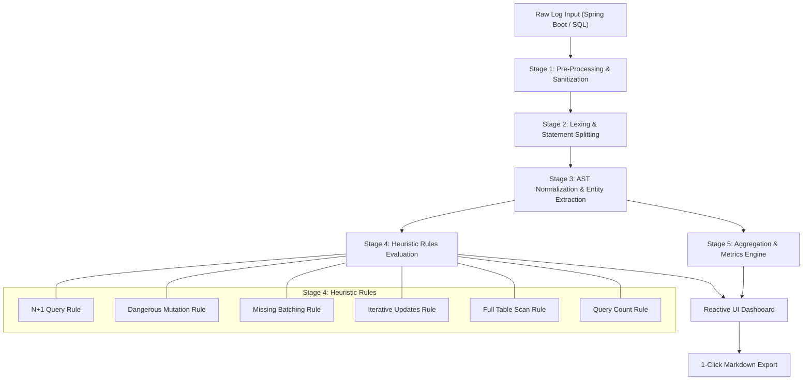

# SQL Analyzer 🔍

[](https://github.com/melina-danhier/sql-analyzer/actions/workflows/ci.yml)
[](https://github.com/melina-danhier/sql-analyzer/actions/workflows/deploy.yml)
[](https://react.dev/)
[](https://www.typescriptlang.org/)
[](https://tailwindcss.com/)
[](https://vite.dev/)
[](https://melina-danhier.github.io/sql-analyzer/)

A high-performance, 100% client-side web application to detect database performance bottlenecks (N+1 queries, missing batching, iterative updates, full table scans) and dangerous mutations directly from raw SQL and Spring Boot / Hibernate log streams.

🚀 **Live Demo:** [https://melina-danhier.github.io/sql-analyzer/](https://melina-danhier.github.io/sql-analyzer/)  
📖 **Realistic Scenario Deep-Dive:** [docs/SAMPLE_SCENARIO.md](./docs/SAMPLE_SCENARIO.md)  
🔬 **Heuristics & Operational Boundaries Guide:** [docs/ANALYSIS_BOUNDARIES.md](./docs/ANALYSIS_BOUNDARIES.md)

---


---

## 🎯 Quick Overview: The Problem & The Solution

### The Problem: Silent Query Explosions in ORMs
Modern Object-Relational Mappers like **Hibernate**, **Spring Data JPA**, and **Entity Framework** make data persistence intuitive, but abstract database operations behind high-level object graphs.
- **The "Silent Killer" in Local Dev**: In local development with 5 mock records, accessing lazy-loaded associations in a loop executes 6 fast queries in ~3 ms and goes unnoticed.
- **Outages Under Production Load**: In production with 500 customers, that same loop silently triggers **$1 + 500 = 501$ database round-trips**. This exhausts connection pools (e.g. HikariCP), adds seconds of network latency, and causes cascading timeouts.
- **Tedious Log Inspection**: Production logs mix thousands of lines of timestamps, thread identifiers, and statements. Manually parsing and correlating queries across hundreds of lines is tedious, time-consuming, and error-prone.

### The Solution: Zero-Install, Client-Side SQL Log Diagnostics
**SQL Analyzer** provides instant clarity:
1. **Paste any raw log stream** (Spring Boot `org.hibernate.SQL`, standard SQL, or multi-line logs).
2. **Instant static heuristic analysis** classifies operations by table, normalizes aliases and parameters, and checks against 6 performance anti-pattern rules.
3. **Actionable diagnostics**: Flags problems with severity ratings (`Critical`, `Moderate`, `Minor`), explains why the pattern is risky, and suggests concrete ORM and SQL fixes.
4. **100% Client-Side Privacy**: Runs completely in the browser. Proprietary entity names, SQL structures, and business data never leave your local machine.

---

## ✨ Key Features

- 🧹 **Automated Log Sanitization**: Strips log prefixes (`Hibernate:`, timestamps, thread identifiers, log levels) and comments without breaking string literals or identifiers.
- 🔍 **Static Anti-Pattern Heuristics**:
  - **N+1 Query Detection**: Identifies repetitive `SELECT` queries on the same entity with matching parameter structures.
  - **Dangerous Mutations**: Catches `UPDATE` and `DELETE` statements executing without a `WHERE` filter.
  - **Missing Batching on INSERT**: Detects loops of single-row `INSERT` operations that should use batching.
  - **Iterative Updates**: Flags repeated single-row updates with identical filter structures.
  - **Full Table Scans / Unbounded Queries**: Warns about `SELECT` statements missing both `WHERE` filters and pagination clauses (`LIMIT`, `TOP`, `FETCH FIRST`).
  - **Query Volume Spikes**: Alerts when query volume within a single request context exceeds safe thresholds.
- 📊 **CRUD Operation Breakdown Matrix**: Visual table breaking down `SELECT`, `INSERT`, `UPDATE`, and `DELETE` volume per database table.
- 📋 **One-Click Markdown Export**: Copies an executive markdown summary to your clipboard, ready for Jira tickets, PR reviews, or Slack incidents.
- ⚡ **Interactive Demo Presets**: Includes 1-click real-world incident presets to explore the tool immediately without needing an external log file.

---

## 🛠️ Tech Stack

| Technology | Purpose |
|---|---|
| **[React 19](https://react.dev/)** | Reactive UI architecture, component state management, and modern hooks |
| **[TypeScript 5](https://www.typescriptlang.org/)** | Strict type safety across AST parsing, query structures, and heuristic rules |
| **[Vite 8](https://vite.dev/)** | Fast developer server and optimized client-side production bundling |
| **[Tailwind CSS v4](https://tailwindcss.com/)** | Clean, responsive design with CSS-first configuration and dark-mode friendly accents |
| **[Vitest](https://vitest.dev/)** | Fast test runner executing unit and integration test suites |
| **[Testing Library](https://testing-library.com/)** | Accessible component and user-interaction verification |
| **[GitHub Actions](https://github.com/features/actions)** | Automated CI/CD pipeline gating quality checks and deploying to GitHub Pages |

---

## 🏗️ Architecture & Processing Pipeline

The entire analysis runs synchronously in the client browser, divided into 5 clear stages:



### Detailed Pipeline Flow:
1. **Pre-Processing & Sanitization (`cleanRawLog`, `stripComments`)**:
   - Strips application log prefixes (e.g. `2026-10-26T14:02:10 DEBUG 14208 --- [nio-8080-exec-4] org.hibernate.SQL :`).
   - Removes single-line (`--`) and multi-line (`/* */`) comments while protecting semicolons and comments within quoted string literals (`'...'`).
2. **Lexing & CRUD Classification (`splitStatements`, `parseLogToGroupedQueries`)**:
   - Splits statements on valid statement boundaries (semicolons outside quotes).
   - Classifies queries into dedicated buckets: `SELECT`, `INSERT`, `UPDATE`, `DELETE`.
3. **AST Normalization & Entity Extraction (`extractTable`, `extractWhereClause`)**:
   - Identifies target tables, safely stripping quotes (`"table"`, `` `table` ``, `[table]`) and schemas (`public.users`).
   - Normalizes table aliases (e.g. `o1_0.customer_id` $\rightarrow$ `customer_id`) and masks literals (`WHERE id = 42` $\rightarrow$ `WHERE id = ?`).
4. **Heuristic Rules Evaluation (`findPotentialProblems`)**:
   - Evaluates the normalized queries against 6 independent rules with multi-tiered severity scoring (`Minor`, `Moderate`, `Critical`).
5. **Aggregation & Visualization (`countTypes`, `groupAndCountByTable`)**:
   - Synthesizes operation statistics per table and populates the dashboard, warnings panel, and clipboard export.

---

## 🛒 Realistic Example Scenario: E-Commerce Incident

Clicking **"Load E-Commerce Incident (Multi-Issue)"** in the app loads a real-world Spring Boot log snippet simulating a customer order checkout workflow:

```log
2026-10-26T14:02:10.120+01:00 DEBUG 14208 --- [nio-8080-exec-4] org.hibernate.SQL : select c1_0.id, c1_0.email, c1_0.full_name, c1_0.status from customers c1_0
Hibernate: select o1_0.id, o1_0.created_at, o1_0.status, o1_0.total_amount, o1_0.customer_id from orders o1_0 where o1_0.customer_id=?
... (repeated 6x)
Hibernate: select oi1_0.id, oi1_0.order_id, oi1_0.product_id, oi1_0.quantity, oi1_0.price from order_items oi1_0 where oi1_0.order_id=?
... (repeated 6x)
Hibernate: update inventory set stock_count=?, reserved_count=? where product_id=?
... (repeated 4x)
Hibernate: insert into audit_events (action, entity_id, user_id, timestamp) values (?, ?, ?, ?)
... (repeated 4x)
```

### Analysis Output at a Glance:

| Detected Issue | Target Table | Severity | What Was Detected |
|---|---|---|---|
| **N+1 Query Bottleneck** | `orders` | **Moderate** (Level 2) | 6 repeated `SELECT` queries with `WHERE customer_id=?` |
| **N+1 Query Bottleneck** | `order_items` | **Moderate** (Level 2) | 6 repeated `SELECT` queries with `WHERE order_id=?` |
| **Iterative Updates** | `inventory` | **Minor** (Level 1) | 4 repetitive single-record `UPDATE` queries |
| **Missing Batching** | `audit_events` | **Minor** (Level 1) | 4 unbatched single-record `INSERT` queries |
| **Full Table Scan** | `customers` | **Minor** (Level 1) | `SELECT` without `WHERE` filter or `LIMIT` clause |
| **Query Volume Warning** | *Global* | **Minor** (Level 1) | 21 database queries executed within a single request |

For the complete architectural walkthrough, root-cause JPA code examples, and Spring configuration fixes, see [📖 docs/SAMPLE_SCENARIO.md](./docs/SAMPLE_SCENARIO.md).

---

## 🔬 Heuristic Rules & Operational Boundaries

> [!IMPORTANT]
> **Static Log Heuristics vs. Live Profiling**:
> SQL Analyzer analyzes query frequencies and structural log patterns without requiring database credentials. It does not measure wall-clock latency (ms) or parse database `EXPLAIN` query plans. This is an intentional design choice: structural flaws are caught before code reaches production environments.

### Comparison & Reference Matrix

| Rule | Severity | Pattern Recognized | Threshold | Typical False Positive | Recommended Solution |
|---|---|---|---|---|---|
| **N+1** | Minor $\rightarrow$ Critical | Repeated `SELECT`s with matching `WHERE` | $\ge 3 / 6 / 10$ | Intentional pagination/polling | `JOIN FETCH`, `@EntityGraph`, `@BatchSize` |
| **Dangerous Statement** | Critical | `UPDATE` / `DELETE` without `WHERE` | 1 query | Staging/temp table cleanup | Add filter, wrap in transaction |
| **Missing Batching** | Minor $\rightarrow$ Critical | Repeated single-row `INSERT`s | $\ge 3 / 6 / 10$ | Dispersed user actions across time | `hibernate.jdbc.batch_size`, multi-row INSERTs |
| **Iterative Updates** | Minor $\rightarrow$ Critical | Repeated `UPDATE`s with matching `WHERE` | $\ge 3 / 5 / 9$ | JPA dirty checking on dirty entities | Bulk JPQL update, batching |
| **Full Table Scan** | Minor | `SELECT` without `WHERE` or `LIMIT` | 1 query | Small lookup/code tables | Add `LIMIT`, `FETCH FIRST`, or pagination |
| **Query Count** | Minor $\rightarrow$ Critical | Total queries across all types | $\ge 20 / 40 / 80$ | Long log traces, batch jobs | Second-level caching, DTO projections |

For deep-dive documentation on heuristic edge cases and operational boundaries, see [📖 docs/ANALYSIS_BOUNDARIES.md](./docs/ANALYSIS_BOUNDARIES.md).

---

## 🚀 Getting Started

### Prerequisites
- [Node.js](https://nodejs.org/) (v18 or higher recommended)
- `npm` (included with Node.js)

### Installation
```bash
git clone https://github.com/melina-danhier/sql-analyzer.git
cd sql-analyzer
npm install
```

### Running Locally
```bash
npm run dev
```
Open [http://localhost:5173](http://localhost:5173) in your browser.

---

## 🧪 Quality Gates & Verification Commands

All quality gates run in CI on every push and pull request:

| Command | Tool | Purpose |
|---|---|---|
| `npm run lint` | ESLint 10 | Validates TypeScript styling, React hooks, and clean syntax |
| `npm run typecheck` | TypeScript Compiler (`tsc`) | Validates types without emitting artifacts |
| `npm test` | Vitest & Testing Library | Executes the automated test suite (128+ tests) |
| `npm run test:watch` | Vitest | Runs tests in watch mode during development |
| `npm run build` | Vite + TypeScript | Compiles and builds the production bundle in `dist/` |

### Run Full Verification Suite Locally:
```bash
npm run lint && npm run typecheck && npm test && npm run build
```

---

## 🤖 Continuous Integration & Deployment (CI/CD)

The repository uses automated GitHub Actions workflows:

1. **Continuous Integration (`.github/workflows/ci.yml`)**:
   - Triggers on every **Pull Request** and **Push** to `main`.
   - Executes ESLint, TypeScript Typecheck, Vitest, and Production Build in parallel.
   - Prevents failing code from merging into the default branch.

2. **Automated Deployment (`.github/workflows/deploy.yml`)**:
   - Triggers on merges to `main`.
   - Re-verifies all quality gates before uploading the production bundle to **GitHub Pages**.
   - Hosted at: [https://melina-danhier.github.io/sql-analyzer/](https://melina-danhier.github.io/sql-analyzer/)

---

## 📄 License

MIT © [Melina Danhier](https://github.com/melina-danhier)
