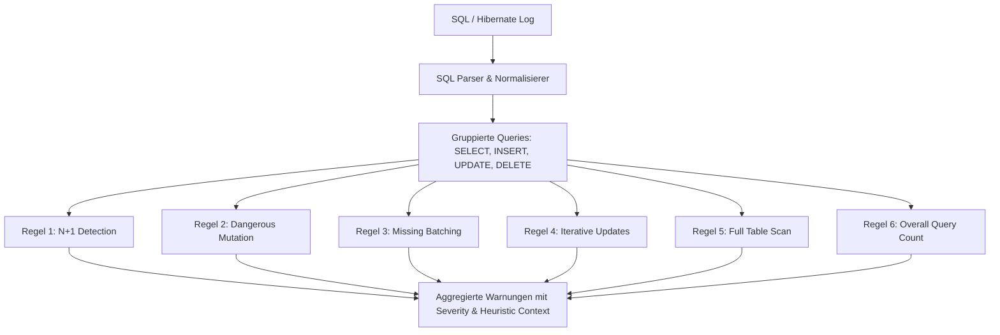

# Analysegrenzen, Heuristiken und Warnungen 🔍

Dieses Dokument beschreibt die Architektur, Funktionsweise, Heuristiken und technischen Grenzen der im **SQL Analyzer** implementierten Analyse-Regeln. Es dient als Referenz und Leitfaden für Code-Reviews und technische Fachgespräche (z. B. im Vorstellungsgespräch für Senior- und Backend-Entwicklerpositionen).

---

## 1. Fundamentales Konzept: Statische Log-Heuristik vs. Dynamisches Runtime-Profiling

### Was das Tool ist
Der **SQL Analyzer** ist ein clientseitiges Analysewerkzeug für SQL- und Hibernate/JPA-Logs. Er nutzt **statische Mustererkennung (Heuristiken)** und syntaktische Normalisierung, um typische Architektur- und ORM-Antipatterns sowie riskante Statements frühzeitig sichtbar zu machen.

### Was das Tool bewusst NICHT ist
> [!IMPORTANT]
> **Warnungen sind heuristische Indikatoren, keine Messung realer Laufzeiten.**
> Das Tool verfügt über keine direkte Datenbankverbindung und führt kein dynamisches Profiling durch.

1. **Keine Laufzeit- oder Latenzmessung**: Das Tool misst weder Ausführungszeiten in Millisekunden noch Netzwerklaufzeiten (Round-Trip Times) oder Verbindungspool-Wartezeiten (HikariCP).
2. **Keine Ausführungspläne (`EXPLAIN` / `EXPLAIN ANALYZE`)**: Es werden keine Kosten (Query Cost), I/O-Reads, Index-Scans oder Verteilungskardinalitäten des datenbankeigenen Cost-Based Optimizers (CBO) ausgewertet.
3. **Keine Zustands- oder Caching-Informationen**: Das Tool weiß nicht, ob Abfragen durch den Hibernate First-Level-Cache (Persistence Context), einen Second-Level-Cache (Redis/Ehcache) oder den DB-Buffer-Pool bedient wurden.

### Warum statische Heuristiken in der Praxis dennoch essenziell sind
In der Softwareentwicklung mit ORM-Frameworks (Spring Data JPA, Hibernate) treten gravierende Bottlenecks wie das N+1-Problem lokal oft unbemerkt auf, weil kleine Entwicklungsdatenbanken im Arbeitsspeicher (< 10 Datensätze) auch bei 100 Abfragen in 3 ms antworten. Erst unter Produktionslast und über Netzwerkstrecken führen dieselben Abfragemuster zu Latenzexplosionen und Pool-Erschöpfung. Statische Log-Heuristiken decken das **strukturelle Kommunikationsmuster** auf, bevor Code in Produktion gelangt.

---

## 2. Detaillierte Spezifikation der Analyse-Regeln



---

### Regel 1: N+1 Query Detection (`checkNPlusOne`)

* **Ziel**: Erkennung von kaskadierenden Einzelselektionen gegen dieselbe Tabelle, typisch für Lazy-Loading von Assoziationen (`@OneToMany`, `@ManyToOne`) in Schleifen oder Serialisierern.
* **Erkanntes Muster**: Mehrere `SELECT`-Statements auf dieselbe Tabelle mit strukturell identischer normalisierter `WHERE`-Klausel.
* **Normalisierungs-Heuristik (`normalizeWhereClause`)**:
  1. Tabellen-Aliase vor Spaltennamen werden entfernt (z. B. `orders0_.customer_id` $\rightarrow$ `customer_id`).
  2. `IN`-Listen werden vereinheitlicht (z. B. `IN (?, ?, ?)` $\rightarrow$ `IN (?)`).
  3. String- und Zahlenliterale werden durch Platzhalter (`?`) ersetzt.
  4. Whitespaces werden komprimiert.
* **Severity-Schwellenwerte**:
  * **Level 1 (Minor)**: $\ge 3$ wiederholte Abfragen
  * **Level 2 (Moderate)**: $\ge 6$ wiederholte Abfragen
  * **Level 3 (Critical)**: $\ge 10$ wiederholte Abfragen

#### ✅ Treffer-Beispiel (Hit)
```sql
SELECT o.id, o.total, o.customer_id FROM orders o WHERE o.customer_id = 101;
SELECT o.id, o.total, o.customer_id FROM orders o WHERE o.customer_id = 102;
SELECT o.id, o.total, o.customer_id FROM orders o WHERE o.customer_id = 103;
```
* **Ausgabe**: `⚠️ N+1 (Minor): Table 'orders' received 3 repeated SELECT queries with matching WHERE structure (customer_id = ?).`

#### ❌ Nicht-Treffer-Beispiel (Non-Hit)
```sql
-- Saubere Batch-Abfrage via IN-Clause (1 Abfrage statt 3):
SELECT id, total, customer_id FROM orders WHERE customer_id IN (101, 102, 103);

-- Verschiedene Tabellen oder unterschiedliche Filterstrukturen (kein N+1):
SELECT id, name FROM customers WHERE id = 101;
SELECT id, total FROM orders WHERE status = 'PENDING';
```

#### Grenzen bei komplexem SQL & Fehlalarme
* **Möglicher Fehlalarm (False Positive)**:
  * Gewolltes Paging oder Polling-Mechanismen mit fixen Abständen.
  * Unterschiedliche fachliche Abfragen innerhalb eines aggregierten Logs über einen längeren Zeitraum.
* **Mögliche Nichterkennung (False Negative)**:
  * Semantisch identische Abfragen mit vertauschter Spaltenreihenfolge im `WHERE` (z. B. `WHERE a = ? AND b = ?` vs. `WHERE b = ? AND a = ?`), da ohne AST-basierten SQL-Compiler nur String-Muster verglichen werden.
  * Komplexe Subselects oder dynamisch generierte Joins mit unterschiedlichen Alias-Hierarchien.

---

### Regel 2: Gefährliche Statements / Mutation ohne Filter (`checkMutationWithoutFilter`)

* **Ziel**: Erkennung von `UPDATE`- oder `DELETE`-Statements, die keinen `WHERE`-Filter besitzen und daher unbeabsichtigt die gesamte Tabelle manipulieren oder leeren würden.
* **Erkanntes Muster**: Ein `UPDATE`- oder `DELETE`-Statement, bei dem weder eine `where`-Eigenschaft geparst wurde noch das Schlüsselwort `WHERE` (außerhalb von Kommentaren `--`, `/* */` oder String-Literalen `'...'`) im Statement vorkommt.
* **Severity-Schwellenwert**: Immer **Level 3 (Critical)**.

#### ✅ Treffer-Beispiel (Hit)
```sql
UPDATE user_accounts SET is_active = false;
DELETE FROM customer_sessions;
```
* **Ausgabe**: `⚠️ Dangerous Statement (Critical): Statement without WHERE clause: DELETE FROM customer_sessions;`

#### ❌ Nicht-Treffer-Beispiel (Non-Hit)
```sql
UPDATE user_accounts SET is_active = false WHERE failed_logins >= 5;
DELETE FROM customer_sessions WHERE expires_at < NOW();

-- Auch Strings mit dem Wort "where" lösen keinen Fehlalarm aus:
UPDATE articles SET title = 'Where is the documentation?' WHERE id = 42;
```

#### Grenzen bei komplexem SQL & Fehlalarme
* **Möglicher Fehlalarm (False Positive)**:
  * Gewollte Batch-Bereinigungen von Staging-, Puffer- oder temporären Importtabellen (z. B. `DELETE FROM staging_import_cache;`).
* **Mögliche Nichterkennung (False Negative)**:
  * `TRUNCATE TABLE` ist ein DDL-Befehl und wird vom Parser nicht als `DELETE` klassifiziert.
  * Statements mit unvollständigen Subselect-Filtern, z. B. `UPDATE users SET role = 'USER' WHERE 1=1;` – syntaktisch existiert ein `WHERE`, semantisch ist die Bedingung jedoch wirkungslos (Tautologie).

---

### Regel 3: Fehlendes Batching bei INSERTs (`checkMissingBatchingInsert`)

* **Ziel**: Identifikation von vielen aufeinanderfolgenden Einzel-`INSERT`-Statements, die zu unnötigen Netzwerk-Round-Trips führen.
* **Erkanntes Muster**: Wiederholte Einzel-`INSERT`-Statements auf dieselbe Zieltabelle.
* **Severity-Schwellenwerte**:
  * **Level 1 (Minor)**: $\ge 3$ INSERTs
  * **Level 2 (Moderate)**: $\ge 6$ INSERTs
  * **Level 3 (Critical)**: $\ge 10$ INSERTs

#### ✅ Treffer-Beispiel (Hit)
```sql
INSERT INTO audit_log (action, user_id) VALUES ('LOGIN', 10);
INSERT INTO audit_log (action, user_id) VALUES ('SEARCH', 10);
INSERT INTO audit_log (action, user_id) VALUES ('LOGOUT', 10);
```
* **Ausgabe**: `⚠️ Missing Batching (Minor): Table 'audit_log' received 3 INSERT queries.`

#### ❌ Nicht-Treffer-Beispiel (Non-Hit)
```sql
-- Multi-Row INSERT in einem einzelnen Statement:
INSERT INTO audit_log (action, user_id) VALUES 
    ('LOGIN', 10), 
    ('SEARCH', 10), 
    ('LOGOUT', 10);

-- Nur 1 oder 2 Einzel-INSERTs (unterhalb Schwellenwert 3):
INSERT INTO users (id, username) VALUES (1, 'melina');
```

#### Grenzen bei komplexem SQL & Fehlalarme
* **Möglicher Fehlalarm (False Positive)**:
  * Statements, die über mehrere Minuten oder durch unabhängige Benutzeraktionen entstehen und in einem aggregierten Logfile gesammelt wurden. Ein Batching über separate HTTP-Threads hinweg ist technisch unmöglich.
* **ORM-Sonderfall (`GenerationType.IDENTITY`)**:
  * Wenn Entitäten in JPA mit `@GeneratedValue(strategy = GenerationType.IDENTITY)` konfiguriert sind, schaltet Hibernate das automatische INSERT-Batching intern zwingend ab, weil die ID erst nach jedem einzelnen Statement via JDBC `getGeneratedKeys()` aus der Datenbank zurückgelesen werden muss. In diesem Fall liegt die Ursache in der ID-Generierungsstrategie (Abhilfe: `SEQUENCE` mit Allocation-Size).

---

### Regel 4: Iterative Updates (`checkIterativeUpdates`)

* **Ziel**: Erkennung von Schleifen, in denen Datensätze einzeln per Primärschlüssel modifiziert werden, statt ein mengenbasiertes Update (`UPDATE ... WHERE ...`) oder JDBC-Batching zu nutzen.
* **Erkanntes Muster**: Mehrere `UPDATE`-Statements auf dieselbe Tabelle mit identischer normalisierter `WHERE`-Klausel.
* **Severity-Schwellenwerte**:
  * **Level 1 (Minor)**: $\ge 3$ UPDATEs
  * **Level 2 (Moderate)**: $\ge 5$ UPDATEs
  * **Level 3 (Critical)**: $\ge 9$ UPDATEs

#### ✅ Treffer-Beispiel (Hit)
```sql
UPDATE inventory SET stock = 10 WHERE item_id = 1;
UPDATE inventory SET stock = 15 WHERE item_id = 2;
UPDATE inventory SET stock = 20 WHERE item_id = 3;
```
* **Ausgabe**: `⚠️ Iterative Updates (Minor): Table 'inventory' received 3 iterative UPDATE queries with matching WHERE structure (item_id = ?).`

#### ❌ Nicht-Treffer-Beispiel (Non-Hit)
```sql
-- Mengenorientiertes Update in einem Statement:
UPDATE inventory SET stock = stock - 1 WHERE category_id = 5;

-- Einzelne Updates mit unterschiedlichen Filterstrukturen:
UPDATE orders SET status = 'SHIPPED' WHERE tracking_code = 'XYZ';
UPDATE orders SET status = 'CANCELLED' WHERE created_at < '2026-01-01' AND paid = false;
```

#### Grenzen bei komplexem SQL & Fehlalarme
* **Möglicher Fehlalarm (False Positive)**:
  * Unabhängige Aktualisierungen unterschiedlicher Spalten (z. B. Query 1 ändert `email`, Query 2 ändert `street`), ausgelöst durch JPA Dirty-Checking für verschiedene geänderte Entitäten im Persistence Context.
* **Architektonischer Trade-off**:
  * Bulk-Updates in JPQL umgehen den Hibernate 1st-Level-Cache und das optimistische Sperren (`@Version`). Entwickler wählen iterative Updates daher oft bewusst, um Konsistenz und Versionsprüfung zu garantieren.

---

### Regel 5: Unbegrenzte Abfragen / Full Table Scan (`checkFullTableScans`)

* **Ziel**: Erkennung potenziell teurer Tabellen-Vollscans durch `SELECT`-Abfragen ohne Selektions- oder Mengenbegrenzung.
* **Erkanntes Muster**: Ein `SELECT`-Statement ohne `WHERE`-Filter und ohne Begrenzungsklausel (`LIMIT`, `TOP`, `FETCH FIRST/NEXT`).
* **Severity-Schwellenwert**: **Level 1 (Minor)**.

#### ✅ Treffer-Beispiel (Hit)
```sql
SELECT id, name, email FROM customers;
SELECT * FROM audit_events;
```
* **Ausgabe**: `⚠️ Full Table Scan (Minor): An unbounded query (possible full table scan) was executed on table 'customers'.`

#### ❌ Nicht-Treffer-Beispiel (Non-Hit)
```sql
-- Mit WHERE-Filter:
SELECT id, name FROM customers WHERE active = true;

-- Mit LIMIT / Pagination:
SELECT id, name FROM customers LIMIT 50;
SELECT TOP 10 * FROM customers;
SELECT * FROM customers ORDER BY id OFFSET 0 ROWS FETCH NEXT 25 ROWS ONLY;
```

#### Grenzen bei komplexem SQL & Fehlalarme
* **Möglicher Fehlalarm (False Positive)**:
  * **Kleine Lookup- / Stammdatentabellen**: Bei Tabellen mit wenigen Zeilen (z. B. `countries` mit 195 Zeilen, `order_status` mit 6 Zeilen) ist ein Full Table Scan der schnellste und vom Cost-Based Optimizer (CBO) bevorzugte Ausführungspfad, da sequentielles Lesen von 1–2 Speicherseiten schneller ist als das Traversieren eines B-Tree-Index.
* **Mögliche Nichterkennung (False Negative)**:
  * **Unindizierte Filterspalten**: `SELECT * FROM large_table WHERE non_indexed_column = 'abc'` besitzt ein `WHERE`, löst auf einer 10-Millionen-Zeilen-Tabelle in der Datenbank jedoch einen 100%igen Full Table Scan aus. Ohne Datenbankschema und Statistiken kann kein statisches Tool dies erkennen.
* **Komplexe Subqueries / Joins**:
  * Wenn der äußere `SELECT` kein `WHERE` besitzt, aber die Datenmenge durch eine innere Subquery oder einen gefilterten `JOIN` auf 1 Zeile beschränkt ist.

---

### Regel 6: Gesamt-Abfragevolumen (`checkCountAll`)

* **Ziel**: Erkennung einer überhöhten Gesamtzahl an SQL-Befehlen in einem einzelnen Log-Auszug.
* **Erkanntes Muster**: Die Gesamtsumme aus `SELECT` + `INSERT` + `UPDATE` + `DELETE` überschreitet Schwellenwerte.
* **Severity-Schwellenwerte**:
  * **Level 1 (Minor)**: $\ge 20$ Abfragen
  * **Level 2 (Moderate)**: $\ge 40$ Abfragen
  * **Level 3 (Critical)**: $\ge 80$ Abfragen

#### ✅ Treffer-Beispiel (Hit)
* Ein Log-Auszug mit 25 beliebigen Statements $\rightarrow$ `⚠️ Query Count (Minor): 25 queries were executed.`

#### ❌ Nicht-Treffer-Beispiel (Non-Hit)
* Ein Log-Auszug mit 14 Statements $\rightarrow$ Kein Warnungseintrag für `Query Count`.

#### Grenzen bei komplexem SQL & Fehlalarme
* **Kontext-Abhängigkeit**:
  * **HTTP-Request-Kontext**: 25 Abfragen zur Darstellung einer Detailseite sind ein klares Alarmsignal für schlechtes Fetching und gefährden den Verbindungspool.
  * **Batch- / ETL-Kontext**: 80 Abfragen bei einem nächtlichen Synchronisationsjob sind verschwindend wenig und völlig unbedenklich.
* **Fehlender Zeitbezug**: Da statische SQL-Logs nicht immer Zeitstempel besitzen, kann das Tool die Abfragedichte (Queries pro Sekunde) nicht ohne Weiteres errechnen.

---

## 3. Vergleichs- und Referenzmatrix

| Regel | Severity | Erkennungsmuster | Schwellenwert | Typischer False Positive | Empfohlene Lösung |
|---|---|---|---|---|---|
| **N+1** | Minor $\rightarrow$ Critical | Wiederholte `SELECT`s mit normalisiertem `WHERE` | $\ge 3 / 6 / 10$ | Gewolltes Paging/Polling | `JOIN FETCH`, `@EntityGraph`, `@BatchSize` |
| **Dangerous Statement** | Critical | `UPDATE` / `DELETE` ohne `WHERE` | 1 Statement | Geplante Bereinigung von Staging-Tabellen | Filter ergänzen, `TRUNCATE` mit Transaktionsabsicherung |
| **Missing Batching** | Minor $\rightarrow$ Critical | Häufige Einzel-`INSERT`s auf dieselbe Tabelle | $\ge 3 / 6 / 10$ | Zeitlich verteilte Nutzeraktionen | `hibernate.jdbc.batch_size`, Multi-Row INSERTs |
| **Iterative Updates** | Minor $\rightarrow$ Critical | Wiederholte `UPDATE`s mit gleicher Filterstruktur | $\ge 3 / 5 / 9$ | JPA Dirty Checking verschiedener Spalten | Bulk-Update per JPQL/Criteria, Batching |
| **Full Table Scan** | Minor | `SELECT` ohne `WHERE` und ohne Limit/Pagination | 1 Statement | Kleine Lookup-Tabellen (z. B. Währungen) | `LIMIT`, `FETCH FIRST`, Keystream-Pagination |
| **Query Count** | Minor $\rightarrow$ Critical | Gesamtzahl aller Statements im Log | $\ge 20 / 40 / 80$ | Batch-Jobs oder längere Logsammelphasen | Caching (2nd-Level), DTO-Projections |

---

## 4. Leitfaden für das technische Vorstellungsgespräch (Interview Talking Points)

Als Software- oder Backend-Entwickler kannst du dieses Wissen im Vorstellungsgespräch gezielt einsetzen:

### Frage 1: "Ist eine N+1-Warnung Ihres Tools ein sicherer Beweis für ein Performance-Problem?"
> **Souveräne Antwort**:
> *"Nein, und genau diese Differenzierung ist mir als Entwickler wichtig. Eine statische Analyse erkennt strukturelle Kommunikationsmuster im Log – in diesem Fall wiederholte Einzelabfragen mit identischem Filteraufbau. 
> Ob dies zu einem spürbaren Problem wird, hängt von drei Faktoren ab:
> 1. Der **Datenmenge in Produktion**: Lokal mit 5 Zeilen dauert das 2 Millisekunden; mit 5.000 Zeilen explodiert die Latenz.
> 2. Der **Netzlatenz**: Liegen App-Server und DB-Cluster in unterschiedlichen Rechenzentrums-Zonen (z. B. 2 ms RTT), erzeugen 1.000 Einzelabfragen mindestens 2 Sekunden reine Netzwerk-Wartezeit.
> 3. Der **Pool-Sättigung**: Serielle Abfragen binden JDBC-Verbindungen im Hikari-Pool länger, was unter Last zu Thread-Starvation führt.
> Das Tool liefert also einen frühzeitigen, hochrelevanten Heuristik-Hinweis für die Code-Review, ersetzt aber kein APM-Monitoring mit echten Laufzeitdaten."*

### Frage 2: "Warum misst das Tool nicht einfach die tatsächliche Ausführungszeit der Abfragen?"
> **Souveräne Antwort**:
> *"Aus zwei Gründen: Architektur und Zuverlässigkeit.
> Erstens läuft der SQL Analyzer als schlanke, clientseitige Web-App direkt im Browser – ohne Zugriff auf Datenbanktreiber oder Produktionsverbindungen.
> Zweitens ist eine reine Zeitmessung in Entwicklungs-Logs trügerisch: Eine N+1-Schleife auf einer lokalen SQLite- oder H2-In-Memory-Datenbank dauert oft nur wenige Millisekunden. Ein Junior-Entwickler könnte fälschlicherweise schließen: 'Läuft schnell, alles gut'. Das statische Erkennen des Musters schützt davor, weil es das architektonische Antipattern unabhängig von der lokalen Rechnerleistung bewertet."*

### Frage 3: "Ihr Tool warnt vor einem Full Table Scan bei SELECTs ohne WHERE. Ist ein Full Table Scan nicht manchmal schneller als ein Index-Scan?"
> **Souveräne Antwort**:
> *"Absolut richtig. Der Cost-Based Optimizer wählt bei kleinen Lookup-Tabellen (z. B. ISO-Ländercodes oder Zahlungsarten) bewusst den Full Table Scan, weil sequentielles Block-I/O schneller ist als das Laden von B-Tree-Index-Blöcken mit anschließendem Random-Access auf die Tabelle.
> Deshalb stuft das Tool diese Warnung bewusst mit der niedrigsten Stufe **Minor (Level 1)** ein und bezeichnet sie im Text explizit als 'possible full table scan'. Die Warnung erinnert daran zu prüfen: Handelt es sich um eine Stammdatentabelle oder droht hier bei wachsender Tabelle ein unbegrenztes Laden von Millionen Zeilen in den JVM-Heap?"*

### Frage 4: "Wo liegen die Grenzen der Regex-basierten SQL-Normalisierung bei komplexen Queries?"
> **Souveräne Antwort**:
> *"Regex-basierte Normalisierung ist extrem schnell und deckt rund 90 % der typischen ORM-Logs (wie die von Hibernate generierten Abfragen) zuverlässig ab.
> Ihre Grenzen liegen in der fehlenden Semantik:
> 1. Sie führt keinen vollständigen AST-Parse durch. Vertauschte `AND`-Bedingungen (`WHERE a=1 AND b=2` vs. `WHERE b=2 AND a=1`) werden als zwei verschiedene Muster gruppiert.
> 2. Bei tief verschachtelten Subqueries, Common Table Expressions (`WITH ... AS`) oder dialektspezifischen SQL-Konstrukten kann eine Regex-Regel übersehen, dass Filter in einer übergeordneten Ebene greifen.
> Für ein statisches Entwickler-Werkzeug ist der Trade-off aus Geschwindigkeit, Null-Installation im Browser und hoher Trefferquote für ORM-Patterns optimal gewählt."*
